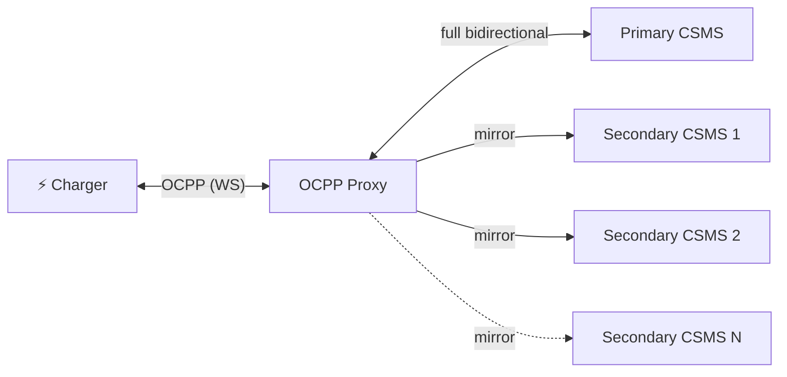

# OCPP Mirror Proxy

> Fork of [joulo-nl/joulo-ocpp-proxy](https://github.com/joulo-nl/joulo-ocpp-proxy) by [Joulo](https://joulo.nl). It adds
> per-charger mirrors, transaction ID translation that survives restarts,
> acknowledged delivery to secondaries, and a Home Assistant add-on.

A lightweight **OCPP WebSocket proxy** that sits between your EV chargers and one or more CSMS backends. It forwards all traffic to a **primary CSMS** and mirrors it to **secondary backends** on a per-charger basis — perfect for monitoring, analytics, or migrating between platforms without reconfiguring your chargers.

Built with Node.js and TypeScript. Supports OCPP 1.6 and 2.0.1.

## How it works



| Direction | Primary CSMS | Secondary CSMS (×N) |
|---|---|---|
| Charger → CSMS | ✅ Forwarded | ✅ Mirrored, except responses |
| CSMS → Charger | ✅ Forwarded | ⚠️ Selected commands only |

The **primary CSMS** has full control — it can send any command back to the charger. Secondaries receive a mirrored copy of everything the charger initiates (boot notifications, meter values, start/stop transactions, etc.), but not the charger's *responses* — a `CALLRESULT` or `CALLERROR` answers a command only the primary sent, so mirroring it would hand a secondary a reply to a request it never made. Secondaries can be configured two ways, which combine freely:

- **Globally**, via `SECONDARY_CSMS_URLS` / `secondary_csms` — every charger is mirrored to those backends under its own ID.
- **Per charger**, via `charger_mappings` — each entry mirrors one `(charger_id, secondary_url)` pair and carries its own mapped charger ID, password, and `id_tag`, so the same backend can be wired to several chargers under different identities.

Most secondary responses are discarded, but a small set of read-only diagnostics (`TriggerMessage`, `GetConfiguration`) are forwarded to the charger so a secondary can still inspect charger state. Secondary connections are best-effort — if one fails, it never affects the charger or the primary link.

#### Secondary commands forwarded to the charger

| Command | Behaviour |
|---|---|
| `TriggerMessage` | Forwarded to charger; response returned to that secondary |
| `GetConfiguration` | Forwarded to charger; response returned to that secondary |
| Other known CSMS commands (`RemoteStartTransaction`, `Reset`, …) | Answered locally with a refusal valid for that command (`Rejected`, `Failed`, `UnlockFailed`, …), or a `NotSupported` CallError where the schema has no refusal (`GetLocalListVersion`, `UpdateFirmware`); charger never sees them |
| Anything else | Refused locally with a `NotSupported` CallError |

OCPP-J allows only one unanswered CALL per direction, and the primary and the
secondaries all send in the same one. So a forwarded CALL is held until the
charger has answered the primary's outstanding CALL, and a primary CALL that
arrives while a forwarded one is on the charger goes next, ahead of other
secondaries. If the charger doesn't answer a forwarded CALL within 30 s, or
isn't connected, that secondary gets a `GenericError` CallError instead.

### Secondary reliability

Mirrored reports are committed to a SQLite outbox **before** they are sent to a
secondary. There is no 100-frame eviction limit and no in-memory fallback.
Pending reports survive charger disconnects, proxy restarts and process crashes.
They resume when that charger reconnects with the same primary, protocol and
secondary identity; incoming HTTP authorization headers are not stored.

- **One outstanding CALL per secondary.** Transaction-dependent reports wait for
  the secondary's confirmed transaction ID. A missing binding blocks delivery
  instead of sending a transaction ID issued by another backend.
- **Stable relay IDs.** Each journal entry gets its own RPC ID, retained across
  retries. Reused charger RPC IDs and late replies cannot acknowledge another
  queued report. Primary traffic keeps the charger's original IDs.
- **No blind start retries.** An OCPP 1.6 `StartTransaction`, or a 2.x
  `TransactionEvent` with `eventType: Started`, whose outcome is unknown is
  retained as `uncertain`. Disconnects, crashes and a 120-second ack timeout do
  not cause another start. Reconcile it with the backend before proceeding.
- **Failures remain inspectable.** `CALLERROR` and known negative responses are
  retained as `rejected`, not successful delivery. Critical boot/transaction
  failures block that secondary's queue. Other unanswered reports are retried
  after 120 seconds, then retained as `unconfirmed` after a second timeout so
  periodic telemetry cannot stall everything indefinitely. They are not deleted.
- **Reconnect and keepalive.** A secondary reconnects every 10 seconds while the
  charger is connected; WebSocket pings run every 30 seconds.

Secondary network failures do not tear down primary charging control. Durable
commits do add local disk I/O to message handling. A runtime storage failure
keeps primary forwarding active but degrades reporting health; new mirror copies
that cannot be committed can still be lost. Monitor free space and reporting
health, not just whether the process is listening.

**Exactly-once delivery requires backend cooperation.** A backend can accept a
start and lose its reply; OCPP 1.6 has no portable query or idempotency key that
lets a proxy distinguish this from non-receipt. This proxy preserves the evidence
and requires a decision rather than guessing. Retries of other reports can still
be duplicates; backends must process their transaction IDs/timestamps correctly.

## Quick start

### Home Assistant App

The easiest way to run the proxy on a Home Assistant installation.

**1. Add the repository**

In Home Assistant, go to **Settings → Apps → Install app**, then open the three-dot menu in the top right → **Repositories**, and add:

```
https://github.com/tomakava/joulo-ocpp-proxy
```

**2. Install**

After the repository loads, find **OCPP Mirror Proxy** in the store and click **Install**.

**3. Configure and start**

Open the app's **Documentation** tab (same as [DOCS.md](DOCS.md)) for setup steps and a description of every
option, then fill in the **Configuration** tab and click **Start**.

---

### Using Docker (recommended)

A pre-built image is published automatically to GitHub Container Registry on every push to `main`.

```bash
docker run -d \
  -p 9000:9000 \
  -e PRIMARY_CSMS_URL=wss://your-primary-csms.example.com/ocpp \
  -v $(pwd)/data:/data \
  ghcr.io/tomakava/joulo-ocpp-proxy:main
```

Global mirrors can be set with `SECONDARY_CSMS_URLS`. Per-charger mirroring is configured via `charger_mappings` in a JSON config file (see below) — that part has no env-var equivalent. Mounting `/data` preserves the delivery journal and transaction bindings across restarts.

### Using Docker Compose

```bash
git clone https://github.com/tomakava/joulo-ocpp-proxy.git
cd joulo-ocpp-proxy
cp .env.example .env
# Edit .env with your CSMS URLs
mkdir -p data
# The container runs as the node user (UID 1000) — make data/ writable:
sudo chown -R 1000:1000 data
docker compose up -d
```

`./data` is mounted at `/data`, where the proxy keeps `state.sqlite` (see
[State persistence](#state-persistence)).

To use a JSON config file instead of `.env`, put it at `data/config.json` and
uncomment the `environment` block in `docker-compose.yml`:

```bash
cp config.example.json data/config.json
```

### From source

```bash
git clone https://github.com/tomakava/joulo-ocpp-proxy.git
cd joulo-ocpp-proxy
npm install
npm run build
mkdir -p data
OUTBOX_FILE=./data/state.sqlite PRIMARY_CSMS_URL=wss://your-csms.example.com/ocpp npm start
```

## Configuration

### Config file (recommended)

Create a `config.json` file (see `config.example.json`) and point the container at it with `CONFIG_FILE`:

```json
{
  "primary_csms_url": "wss://your-primary-csms.example.com/ocpp",
  "charger_mappings": [
    {
      "secondary_url": "wss://analytics.example.com/ocpp",
      "charger_id": "CHARGER-001"
    },
    {
      "secondary_url": "wss://other-backend.example.com/ocpp",
      "charger_id": "CHARGER-001",
      "mapped_charger_id": "ext-CHARGER-001",
      "password": "secret123",
      "id_tag": "HARDCODED-TAG"
    }
  ],
  "log_level": "info",
  "log_debug_message_max_length": 120
}
```

Each config file option maps to the environment variable of the same name in
upper case (`log_level` → `LOG_LEVEL`,
`primary_csms_append_charge_point_id` → `PRIMARY_CSMS_APPEND_CHARGE_POINT_ID`).
Set `log_debug_message_max_length` to `0` or `""` to disable truncation
entirely.

An option of the wrong type is reported in the log and ignored, so a typo in the
config file falls back to the default instead of stopping the proxy. A missing
`primary_csms_url` is fatal — the proxy logs one line saying so and exits.

#### Primary routes

`primary_csms_routes` lets one proxy serve chargers that belong to different
primaries. Each entry maps a path to a primary; the charger selects it with
the part of its URL in front of the charge point ID:

```json
{
  "primary_csms_url": "wss://default-csms.example.com/ocpp",
  "primary_csms_routes": [
    { "path": "site-a", "url": "wss://site-a-csms.example.com/ocpp" },
    {
      "path": "site-b",
      "url": "wss://fixed-csms.example.com/XXXXXXXX",
      "append_charge_point_id": false
    }
  ]
}
```

| Charger connects to | Primary |
|---|---|
| `ws://proxy:9000/site-a/CHARGER-001` | `wss://site-a-csms.example.com/ocpp/CHARGER-001` |
| `ws://proxy:9000/site-b/CHARGER-002` | `wss://fixed-csms.example.com/XXXXXXXX` |
| `ws://proxy:9000/ocpp/CHARGER-003` | `wss://default-csms.example.com/ocpp/CHARGER-003` |

- `path` is matched exactly, ignoring leading and trailing slashes, and may
  have several segments (`ocpp/site-a`).
- `append_charge_point_id` is optional and defaults to
  `primary_csms_append_charge_point_id`.
- A path with no route uses `primary_csms_url`. When `primary_csms_url` is
  not set, such chargers are refused with close code `1008` — and
  `primary_csms_url` is then no longer required.
- Secondaries and `charger_mappings` ignore the path: they match on the charge
  point ID only. Sessions are keyed by charge point ID too, so two chargers
  with the same ID on different paths replace each other.

There is no env-var equivalent.

There are two ways to configure secondaries, and they can be combined:

- `secondary_csms` / `SECONDARY_CSMS_URLS` — global mirrors that receive traffic
  from **every** charger, under the charger's own ID.
- `charger_mappings` — mirrors wired to **one** charger. Each entry declares a
  `(charger_id, secondary_url)` pair; `mapped_charger_id`, `password`, and
  `id_tag` are per-pair overrides for backends that expect a different charger
  identity than the primary. There is no env-var equivalent.

A charger with no global mirrors and no mappings is sent only to the primary.

#### Protocol support for mapped secondaries

A mapping's URL and credentials (`mapped_charger_id` in the connect URL,
`password` for HTTP Basic auth) apply to any OCPP version the proxy accepts.

The **payload rewrites are OCPP 1.6 only** — they match 1.6 action names and
payload keys:

| Rewrite | 1.6 | 2.0 / 2.0.1 |
|---|---|---|
| Charger identity in `BootNotification` | `chargePointSerialNumber` is replaced | Not applied — 2.0.1 sends `chargingStation.serialNumber` |
| `id_tag` substitution in `StartTransaction` | `idTag` is replaced | Not applied — 2.0.1 authorizes with `idToken` in `TransactionEvent` |
| Transaction ID translation | `transactionId` in `MeterValues` / `StopTransaction` is remapped | Not needed — in 2.0.1 the charging station generates the transaction ID, so it is already the same for every CSMS |

So on a 2.0/2.0.1 session a mapped secondary is reached under its mapped ID with
its own credentials, but sees the charger's payloads unmodified. Setting
`id_tag` or `mapped_charger_id` expecting the payload rewrites will have no
effect there.

### Environment variables

| Variable | Required | Default | Description |
|---|---|---|---|
| `CONFIG_FILE` | No | `/data/options.json` | Path to the JSON config file |
| `STATE_FILE` | No | `/data/state.json` | Read-only legacy JSON mappings, imported once into the journal |
| `OUTBOX_FILE` | No | `STATE_FILE` with `.json` replaced by `.sqlite` (normally `/data/state.sqlite`) | Persistent SQLite outbox; a non-JSON legacy filename gets `.sqlite` appended |
| `PORT` | No | `9000` | Port the proxy listens on |
| `PRIMARY_CSMS_URL` | No* | — | WebSocket URL of your primary CSMS (the default when `primary_csms_routes` is set) |
| `SECONDARY_CSMS_URLS` | No | — | Comma-separated list of secondary CSMS URLs mirrored for every charger |
| `PRIMARY_CSMS_APPEND_CHARGE_POINT_ID` | No | `true` | `true`/`false`; when `true`, append incoming charge point ID to `PRIMARY_CSMS_URL`. Config file: `primary_csms_append_charge_point_id` |
| `SECONDARY_CSMS_APPEND_CHARGE_POINT_ID` | No | `true` | `true`/`false`; when `true`, append the charge point ID to secondary URLs (the `mapped_charger_id` for mapped secondaries). Config file: `secondary_csms_append_charge_point_id` |
| `LOG_LEVEL` | No | `info` | `debug`, `info`, `warn`, or `error` |
| `LOG_DEBUG_MESSAGE_MAX_LENGTH` | No | `120` | Max char length for debug payload summaries. `0` or empty disables truncation |

\* Required if not set in the config file, unless `primary_csms_routes` is configured. Environment variables take precedence over the config file. Secondary mirroring requires the JSON config file — there is no env-var equivalent for `charger_mappings`.

### State persistence

The journal atomically records report attempts, acknowledgements and OCPP 1.6
transaction bindings. It uses SQLite's full synchronous commits and an exclusive
single-owner lock, not delayed JSON snapshots. Active bindings do not expire
after seven days. Closed transaction metadata is removed after seven days only
when no retained report refers to it.

On upgrade, the old version-1 JSON file is imported once and left untouched.
Legacy mappings are assigned to the first matching configured primary; changing
primary routes during the upgrade requires reconciliation. Corrupt legacy data,
an unsupported database version, or an unwritable database stops startup rather
than silently starting with empty state. An old JSON file becomes stale after
the upgrade: do not downgrade an active session assuming it contains new receipts.

Older releases kept queued reports only in RAM; that queue cannot be imported
from `state.json`. Drain the old outbox and upgrade between charging sessions.
This upgrade cannot recover reports that an older release already discarded.

Mount a writable persistent volume at `/data`; the Home Assistant app already
does this. The journal is mode `0600` and contains private charging data, including
possible RFID tags and vendor payloads. Protect its backups and exports. Successful
routine reports are removed; failed reports, operator receipts and 2.x start
deduplication receipts are retained. Size the volume for outages and retained data;
no finite disk can guarantee storage for an unlimited outage.

Home Assistant backups are **cold**: the app is stopped before copying the
database, then restarted. Expect a brief OCPP reconnect; an in-flight start may
need reconciliation. For Docker/manual backups, stop the proxy before copying
its database. Do not copy a live SQLite file as though it were a consistent backup.

#### Reporting health and reconciliation

`GET /health` returns JSON with queued/error counts and the oldest pending age.
It returns HTTP **503** for storage faults, unresolved reports, or a queue waiting
at least 120 seconds. Otherwise it returns 200. This is delivery health, not proof
of backend connectivity when there is no work, subsidy eligibility or payment.
Keep the Home Assistant TCP watchdog for liveness; restarting on reporting
failures does not resolve ambiguous receipts.

Administration is **offline only**. Stop the proxy first: its exclusive database
lock refuses a second proxy or administrator. There is no unauthenticated remote
write API. With a built checkout:

```bash
node dist/delivery-cli.js status --db ./data/state.sqlite
node dist/delivery-cli.js list --db ./data/state.sqlite
node dist/delivery-cli.js export --db ./data/state.sqlite > private-reports.json
```

For Docker Compose, stop `ocpp-proxy`, then run the same command in a one-shot
container sharing its data volume, for example:

```bash
docker compose stop ocpp-proxy
docker compose run --rm --no-deps --entrypoint node ocpp-proxy dist/delivery-cli.js list
```

After confirming the outcome **with the backend**, resolve the listed delivery:

```bash
# Backend accepted this start; its transaction number is known.
node dist/delivery-cli.js resolve --db ./data/state.sqlite --id 42 \
  --outcome received --secondary-transaction-id 987 --note "Confirmed with backend operator"

# Backend explicitly confirmed non-receipt: permit another attempt.
node dist/delivery-cli.js resolve --db ./data/state.sqlite --id 42 \
  --outcome not_received --note "Backend operator confirmed no accepted request"
```

For a missing primary response, also supply the confirmed
`--primary-transaction-id`. `bind` attaches confirmed primary/secondary IDs to a
blocked orphan meter/stop report. `discard --id ... --note ...` is an explicit
decision to abandon a report; discarding a start also discards that session's
dependent reports, without sending another backend's IDs. It does not stop the
charger, reverse an accepted backend transaction, or erase the evidence.
`list` omits raw payloads; `export` includes them. Protect both as private data.
Restart the proxy after administration; pending delivery resumes on the next
charger connection. Home Assistant users need host-level container access or
an offline app-data backup/restore workflow to administer the database.

## Charger setup

Point your charger's OCPP backend URL to the proxy instead of the CSMS directly:

```
Before:  wss://your-csms.example.com/ocpp/CHARGER-001
After:   ws://proxy-host:9000/CHARGER-001
```

The proxy can append the charge point ID from the incoming URL to each upstream CSMS URL. For a mapped secondary it appends that mapping's `mapped_charger_id` instead (falling back to the charger's own ID when no override is set).

By default, both primary and secondary URLs append the charge point ID. For CSMS endpoints that use a fixed endpoint URL (for example `wss://fixed-csms.example.com/XXXXXXXX`), set the corresponding toggle to `false`.

If your charger connects to `ws://proxy:9000/CHARGER-001` and appending is enabled, the proxy connects to:

- Primary: `wss://your-primary-csms.example.com/ocpp/CHARGER-001`
- Each matching secondary: `<secondary_url>/<mapped_charger_id or CHARGER-001>`

With `PRIMARY_CSMS_APPEND_CHARGE_POINT_ID=false` and `SECONDARY_CSMS_APPEND_CHARGE_POINT_ID=true`, this becomes:

- `wss://fixed-csms.example.com/XXXXXXXX`
- `wss://analytics.example.com/ocpp/CHARGER-001`

### URL patterns

The proxy accepts any of these URL patterns and extracts the last path segment as the charge point ID. Whatever comes before it selects a [primary route](#primary-routes) if one matches:

```
ws://proxy:9000/CHARGER-001
ws://proxy:9000/ocpp/CHARGER-001
ws://proxy:9000/ws/CHARGER-001
```

### Authentication

If the charger sends HTTP Basic Auth credentials, the proxy forwards the `Authorization` header to all upstream CSMS backends as-is.

### Sub-protocol negotiation

The proxy negotiates OCPP sub-protocols (`ocpp1.6`, `ocpp2.0`, `ocpp2.0.1`) between the charger and the upstream backends automatically.

## Use cases

### Multi-backend monitoring

Run your chargers against your primary platform while mirroring data to your own analytics or energy management system.

### Platform migration

During a CSMS migration, mirror traffic to the new platform and verify it processes messages correctly before switching over.

### Development & debugging

Mirror production charger traffic to a local development CSMS for testing without affecting the live system.

### Compliance & auditing

Send a copy of all OCPP messages to an audit system for regulatory compliance.

## Logging

Logs are structured JSON written to stdout/stderr:

```json lines
{"time":"2026-04-07T10:00:00.000Z","level":"info","tag":"proxy","msg":"proxy listening","port":9000,"primary":"wss://csms.example.com/ocpp","secondaries":[]}
{"time":"2026-04-07T10:00:01.000Z","level":"info","tag":"CHARGER-001","msg":"session started","primary":"wss://csms.example.com/ocpp","secondaries":[],"protocol":"ocpp1.6"}
{"time":"2026-04-07T10:00:01.500Z","level":"debug","tag":"CHARGER-001","msg":"charger → proxy","message":"[OCPP CALL] (abc123): [2, \"abc123\", \"BootNotification\", {\"chargePointVendor\":\"Acme\"}]"}
```

Set `LOG_LEVEL=debug` for OCPP payload summaries (including message-type-prefixed payloads for troubleshooting).
Set `LOG_DEBUG_MESSAGE_MAX_LENGTH` to a positive integer to cap logged `message` values in debug output.
Leave it unset for the default, or set it to `0` or empty to disable truncation.

## Building the Docker image

```bash
docker build -t joulo-ocpp-proxy .
```

The image uses a multi-stage build. The Home Assistant add-on runs it as root (per the add-on contract); the bundled `docker-compose.yml` sets `user: node` so plain Docker deployments run unprivileged.

## Contributing

Contributions are welcome! Please open an issue first to discuss what you'd like to change.

1. Fork the repository
2. Create a feature branch (`git checkout -b feature/my-feature`)
3. Commit your changes
4. Push to your branch
5. Open a Pull Request

## About

This fork is maintained by [Tomakava](https://github.com/tomakava). Report
problems with it in [this repository's issues](https://github.com/tomakava/joulo-ocpp-proxy/issues),
not upstream.

The original proxy was built by [Joulo](https://joulo.nl), a Dutch platform that
helps EV owners earn rewards for charging at home with green energy. Changes that
are useful beyond this fork are offered back to
[joulo-nl/joulo-ocpp-proxy](https://github.com/joulo-nl/joulo-ocpp-proxy).

## License

[MIT](LICENSE) — use it however you like.
